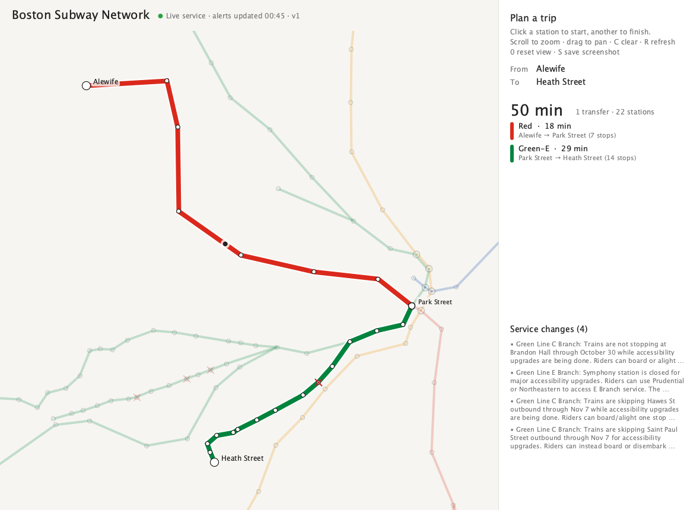
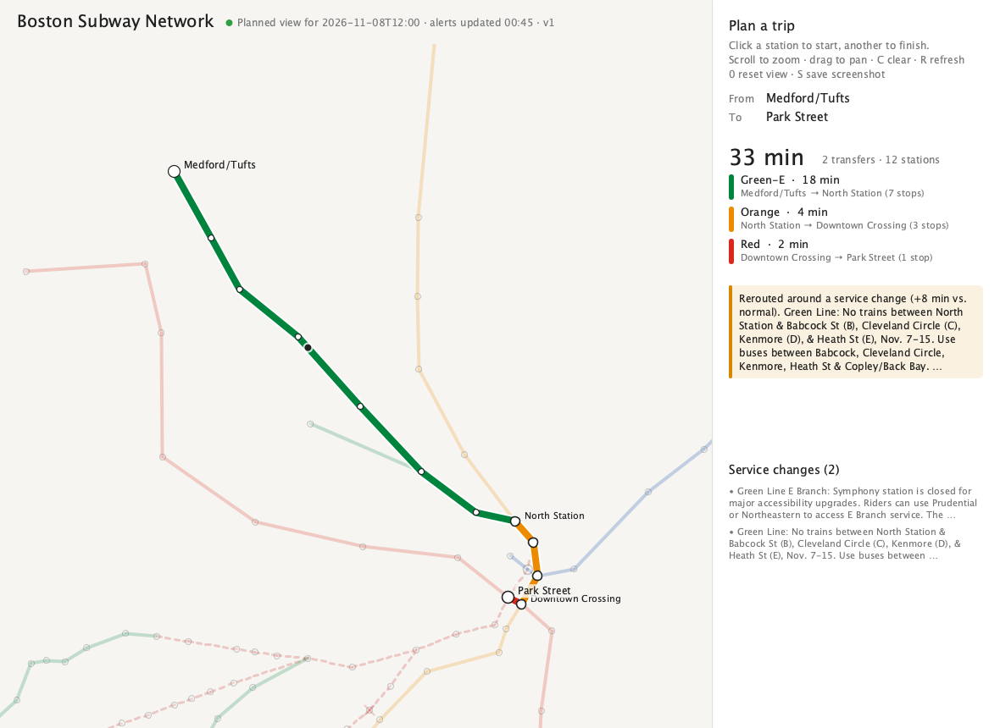
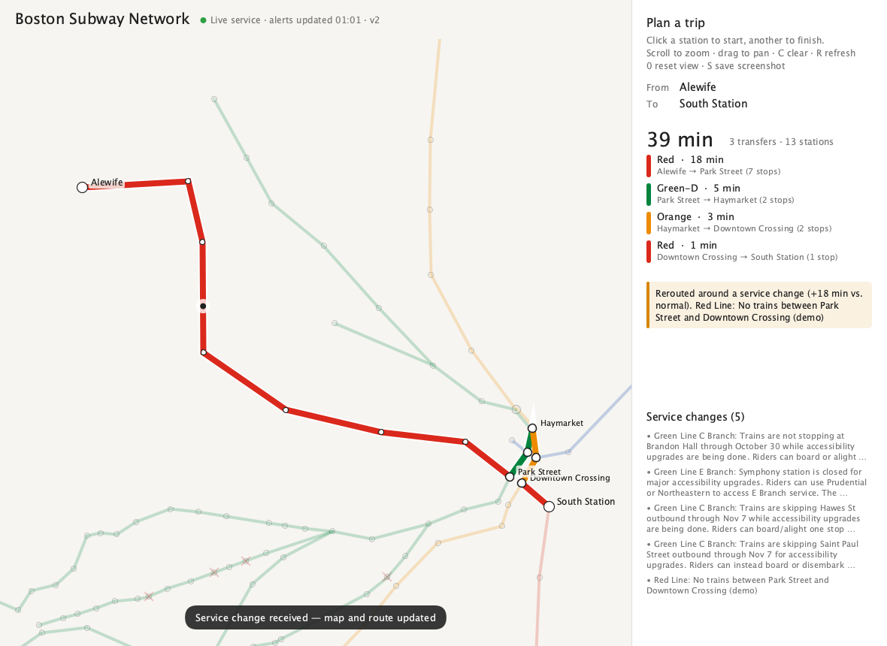

# Boston Subway Network Optimization & Visualization

[](https://github.com/pathakbaibhav/Boston-Subway-Network-Visualization/actions/workflows/ci.yml)
[](https://github.com/pathakbaibhav/Boston-Subway-Network-Visualization/actions/workflows/pages.yml)

A route-optimization backend and live visualization for Boston's MBTA subway, the "T":
- The network is modeled as a weighted graph built from real MBTA data.
- Fastest routes are computed with Dijkstra's algorithm and served over a REST API.
- The routes are drawn on an interactive Processing map that reroutes live when service changes.

**▶ Live demo: <https://pathakbaibhav.github.io/Boston-Subway-Network-Visualization/>**



## Highlights

- **Real data:** 125 stations, 127 track segments and 8 routes, built from the MBTA V3 REST API.
  Travel times are averaged from 48–238 real scheduled trips per segment.
- **Graph engine:** an adjacency-list graph with heap-based Dijkstra, O(E log V). It is
  **9× faster** than the original adjacency-matrix version across all **7,750 station pairs** and
  uses **62% less graph memory**. An LRU route cache reaches a **77% hit rate** on a realistic
  workload. See [BENCHMARKS.md](BENCHMARKS.md).
- **Live service changes:**
  - A BeautifulSoup scraper of mbta.com is merged with structured API alerts.
  - Active alerts become closed stations or per-line closed segments, and routes reroute around them.
  - A planned disruption can be checked ahead of time ("what-if" planning).
- **REST API:** a FastAPI service with OpenAPI docs and a background alert refresh.
- **Processing visualization:** a desktop map in [py5](https://py5coding.org/) and a web map in
  [p5.js](https://p5js.org/). Both have color-coded lines, an animated route, and live rerouting.
- **One engine in two languages:** the website runs a JavaScript port of the engine, which is
  tested to match the Python engine on every station pair.
- **CI and deployment:** 71 Python tests and 13 JavaScript tests run on every push. A scheduled
  GitHub Actions pipeline publishes fresh alerts to GitHub Pages every 30 minutes.

## Architecture

```
  MBTA V3 API ─┐
               ├─► transit/pipeline.py ─► network.json (stations, segments, travel times)
  mbta.com ────┘   (requests, BeautifulSoup)   alerts.json (API + scraped, merged)
                                │
                                ▼
            transit/graph.py + transit/closures.py
            adjacency list · heap Dijkstra · closures · LRU cache
                    │                                   │
                    ▼                                   ▼
          api/ (FastAPI REST) ──► viz/ (py5)      web/ (GitHub Pages)
          background alert refresh   desktop map   p5.js map + JS port of the engine,
                                                   live MBTA alerts polled in the browser
```

## Data Pipeline

`transit/pipeline.py` builds two datasets from two independent sources.

**Network** (`data/processed/network.json`, plus `stations.csv`, `segments.csv`, `lines.csv`)
- Topology comes from each route's canonical stop sequence. Green Line branches share trunk
  segments, so they are stored once with every route that runs over them.
- Each segment's travel time is the **mean of real scheduled trips** (10:00–14:00 on a weekday).
  Segments with no scheduled trips, e.g. during a shutdown, fall back to later weekdays, then to a
  distance-based estimate, and are tagged `minutes_source: "estimated"`.
- The network is validated before writing. Unknown stations, duplicate segments, non-positive
  times, out-of-area coordinates and disconnected stations all fail the build.

**Alerts** (`data/processed/alerts.json`, plus `alerts.csv`)
- The **MBTA API** provides structured alerts: effect, severity, and affected platforms mapped to
  stations.
- The public alerts page on mbta.com is scraped with **BeautifulSoup**, honoring `robots.txt`. Its
  free text is parsed into the same schema:
  - The effect type comes from keywords.
  - Affected stations are found by matching station names. This handles abbreviations like
    "Babcock St" and ignores direction phrases like "Alewife platform".
- The two sources are merged by alert id. Scraping adds alerts that the API's route filter misses
  (elevators, escalators) and keeps alerts available if the API is down.

```bash
python -m transit.pipeline all        # network + alerts
python -m transit.pipeline alerts     # refresh alerts only
```

## Graph Engine

`transit/graph.py`:
- **Route-level nodes.** Each node is a (station, route) pair, and transfer edges join a
  station's route nodes. Changing trains costs 4 minutes (the average wait), so routes come back
  as per-line legs. The full network is 155 nodes and 202 edges.
- **Dijkstra with a binary heap** (`heapq`, lazy deletion): O(E log V) per query, with early exit
  at the destination. A single-source variant builds the all-pairs table in about 15 ms.
- **Closures.** A closed station is passed through but can't be used for boarding or transfers. A
  closed segment can't be ridden. Closures are per line, so a Green Line suspension leaves the
  parallel Orange Line segment open.
- **LRU route cache.** It stores compact results (minutes plus node path) and clears itself when
  closures change.

### Benchmarks

Measured with `python -m scripts.benchmark --write` against the original homework implementation,
which used a dense adjacency matrix and O(V²) Dijkstra (ported to `scripts/baseline_matrix.py`).
Full results are in [BENCHMARKS.md](BENCHMARKS.md).

| | Original (matrix) | Now (adjacency list) |
|---|---|---|
| Graph memory, same information | 264.5 KB | 27.9 KB (**−89.5%**) |
| Graph memory, full route-level graph | 264.5 KB | 100.1 KB (**−62.2%**) |
| All 7,750 station pairs | 3.65 s | 0.40 s (**9×** faster) |
| Repeated queries (Zipf workload) with LRU cache | n/a | 76.9% hit rate, 2.9× faster |
| 2,000-station synthetic network: memory / query | 61.4 MB / 114 ms | 1.4 MB / 0.54 ms |

Both implementations return identical travel times on all 7,750 pairs when the transfer penalty
is set to 0, which matches the original model.

## REST API

`api/` is a FastAPI service. Run it with `uvicorn api.main:app` and open the docs at
<http://127.0.0.1:8000/docs>.

| Endpoint | Description |
|---|---|
| `GET /health` | Status, alert freshness, closure version, route-cache stats |
| `GET /lines` | Lines with official colors |
| `GET /stations?line=&q=` | Stations, filterable by line group and name |
| `GET /stations/{station}` | One station (id or name) with neighbors and active alerts |
| `GET /network` | Full graph for drawing, with `closed` flags |
| `GET /route?from=&to=&at=` | Fastest route with legs, transfers and disruption info |
| `GET /alerts?active=&effect=&line=` | Merged API and scraped alerts |
| `GET /closures?at=` | Closed stations and segments, and the alerts behind them |
| `POST /alerts/refresh` | Fetch alerts now |

- A background task refreshes alerts every `ALERTS_REFRESH_SECONDS` (default 120).
- Every route response reports:
  - `disrupted`: whether live closures changed the route;
  - `normal_minutes`: the same trip under normal service;
  - `alert_ids`: the alerts responsible.
- If no train route exists, the API returns `409` with the blocking alerts.
- Stations can be given by id or by name, case-insensitive. Typos get suggestions.
- `at=` plans against disruptions scheduled for that time (Boston time if no offset):

```bash
curl "localhost:8000/route?from=Haymarket&to=North%20Station&at=2026-11-08T12:00"
# → rides the Orange Line, because the Green Line is suspended between these stations that day
```

## Live Map (Processing, desktop)

`viz/subway_map/` is a Processing sketch written in Python with py5, and gets all of its data from
the REST API:
- Click two stations. The map zooms to the trip, dims everything else, colors each leg by its line
  and animates a pulse along the route.
- A side panel lists the legs, transfers, and the change from normal service.
- A background thread checks the API's closure version. When it changes, the map reloads closures,
  re-plans the trip and announces the change.

**Planned disruption:** during the November Green Line suspension, Medford/Tufts → Park Street is
rerouted via the Orange and Red Lines.



**Live service change:** the map is open when a suspension arrives (a simulated alert, labeled
"demo"). Within one check, the route is rerouted and the change is announced.



## Website (GitHub Pages)

GitHub Pages serves only static files, so the website does the backend's work in the browser:

- **`web/js/app.js`**: a p5.js map with the same drawing, animation and interaction as the desktop
  map. The HTML panel has station pickers, Boston-time trip planning and shareable links
  (`?from=Alewife&to=Heath%20Street&at=2026-11-08T12:00`), and works on phones.
- **`web/js/graph.js`, `alerts.js`**: JavaScript ports of the graph engine and the
  alert-to-closure rules. `scripts/export_web_fixtures.py` exports the Python engine's results, and
  `web/tests` checks the JavaScript engine against them on **all 7,750 pairs** in three scenarios.
- **Live alerts:** the browser polls the MBTA API every minute. GitHub Actions
  (`.github/workflows/pages.yml`) runs the Python pipeline, including the scraper, every 30 minutes
  and publishes the merged alerts, which are also the fallback if the API is unreachable.

## Getting Started

**Requirements:** Python 3.10+. For the desktop map, a Java 17+ runtime (installed below). For the
JavaScript tests, Node 18+.

```bash
git clone https://github.com/pathakbaibhav/Boston-Subway-Network-Visualization.git
cd Boston-Subway-Network-Visualization
python3 -m venv .venv && source .venv/bin/activate
pip install -r requirements.txt

# Optional: an MBTA API key raises the rate limit (https://api-v3.mbta.com/register)
cp .env.example .env          # then set MBTA_API_KEY=<key> (no space after =)

# One-time Java 17 install for the desktop map. It goes to ~/.jre, and py5 finds it automatically.
python -c "import jdk; jdk.install('17', jre=True)"
```

A network snapshot is committed, so everything runs without first running the pipeline.

```bash
uvicorn api.main:app                                     # REST API → http://127.0.0.1:8000/docs
python -m viz.subway_map                                 # desktop map (with the API running)
python -m viz.subway_map --route Alewife "Heath Street"  # open with a trip selected
python -m viz.subway_map --at 2026-11-08T12:00           # network as planned for that time

python -m scripts.build_site && python -m http.server -d _site 8080   # website at :8080
python -m transit.pipeline all                           # refresh network + alerts
python -m scripts.benchmark --write                      # re-run benchmarks
```

Desktop map controls: click stations to plan, scroll to zoom, drag to pan, `C` clear,
`R` refresh alerts, `0` reset view, `S` save a screenshot.

## Testing

```bash
pytest                                  # 71 Python tests
node --test web/tests/*.test.mjs        # 13 JavaScript tests, checked against Python fixtures
```

Tests run offline against fakes and fixtures. They don't call the MBTA API or mbta.com, and they
don't need Java. After changing the Python engine, re-export the browser fixtures with
`python -m scripts.export_web_fixtures`. A pytest test fails if you forget.

## Project Structure

```
├── transit/                # Core package
│   ├── config.py           # Paths and settings
│   ├── models.py           # Data schema (Line, Station, Segment, Alert, Network) + validation
│   ├── mbta_api.py         # MBTA V3 REST client with rate-limit/5xx retries
│   ├── scraper.py          # BeautifulSoup alerts scraper and free-text parsing
│   ├── storage.py          # JSON/CSV readers and writers
│   ├── pipeline.py         # Builds network + alerts (CLI)
│   ├── graph.py            # Adjacency-list graph, heap Dijkstra, closures, LRU route cache
│   └── closures.py         # Active alerts → closed stations/segments at a point in time
├── api/                    # FastAPI service: main.py, state.py, schemas.py
├── viz/subway_map/         # py5 desktop map: sketch.py, model.py, feed.py, client.py
├── web/                    # GitHub Pages site: p5.js map + JS engine, tests/
├── scripts/                # benchmark.py, baseline_matrix.py, build_site.py, export_web_fixtures.py
├── tests/                  # pytest suite
├── data/processed/         # Committed network snapshot (alerts are generated)
├── docs/                   # Screenshots
├── .github/workflows/      # ci.yml, pages.yml
└── BENCHMARKS.md
```

## Tech Stack

Python · requests · BeautifulSoup · MBTA V3 API · FastAPI · Pydantic · Uvicorn · py5 (Processing) ·
p5.js · JavaScript (ES modules) · GitHub Actions · GitHub Pages · pytest · node:test

## Project History

This started as Homework 4 for **EECE 5642: Data Visualization** at Northeastern University
(Spring 2024). That version drew a hand-entered T network in Processing and found shortest paths
with an adjacency-matrix Dijkstra. The original submission is preserved at the git tag
[`hw4-original`](https://github.com/pathakbaibhav/Boston-Subway-Network-Visualization/tree/hw4-original).

It was rebuilt in 2026 in phases, each its own pull request:

| Phase | Scope | PR |
|---|---|---|
| 0 | Repo restructure and tooling | [#1](https://github.com/pathakbaibhav/Boston-Subway-Network-Visualization/pull/1) |
| 1 | Data pipeline: MBTA V3 API client, BeautifulSoup scraper, JSON/CSV schema | [#2](https://github.com/pathakbaibhav/Boston-Subway-Network-Visualization/pull/2) |
| 2 | Graph engine: adjacency list, heap Dijkstra, LRU cache, benchmarks | [#3](https://github.com/pathakbaibhav/Boston-Subway-Network-Visualization/pull/3) |
| 3 | REST API with live alert-driven routing | [#4](https://github.com/pathakbaibhav/Boston-Subway-Network-Visualization/pull/4) |
| 4 | Processing (py5) live map | [#5](https://github.com/pathakbaibhav/Boston-Subway-Network-Visualization/pull/5) |
| 5 | Website on GitHub Pages, CI | [#6](https://github.com/pathakbaibhav/Boston-Subway-Network-Visualization/pull/6) |
| 6 | Cleanup and documentation | [#7](https://github.com/pathakbaibhav/Boston-Subway-Network-Visualization/pull/7) |

## License

For educational and portfolio use.
